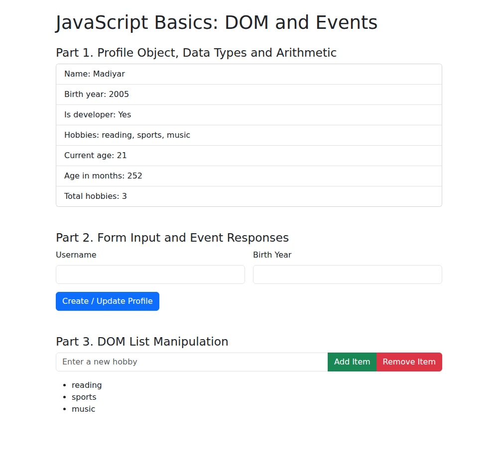
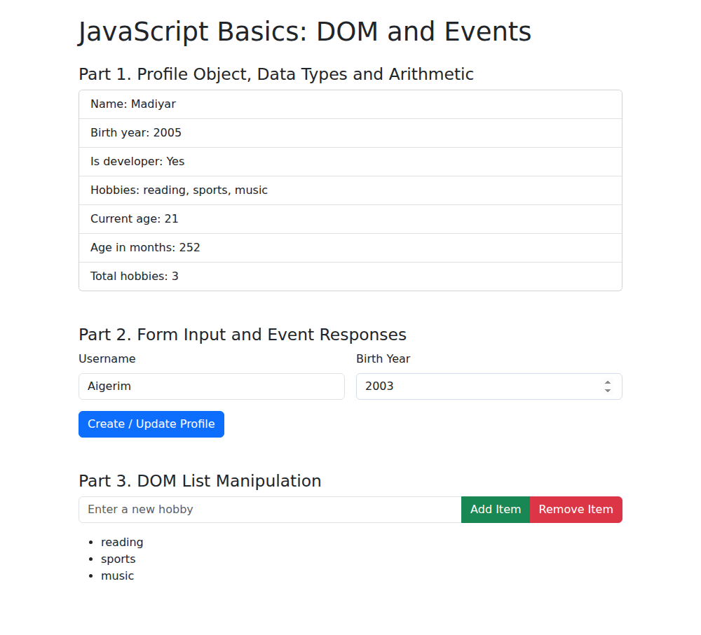
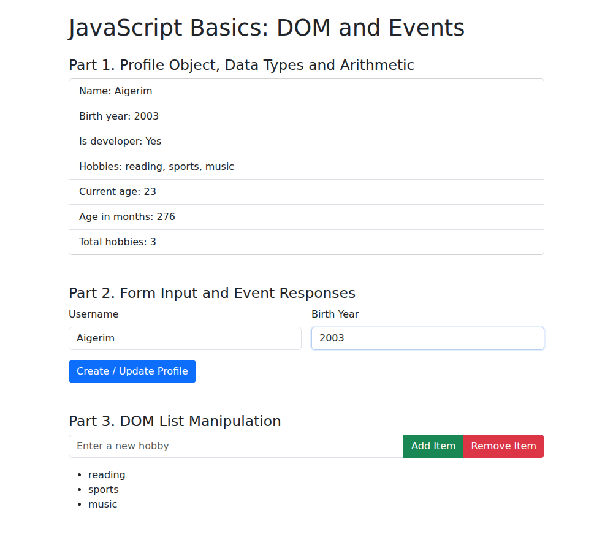
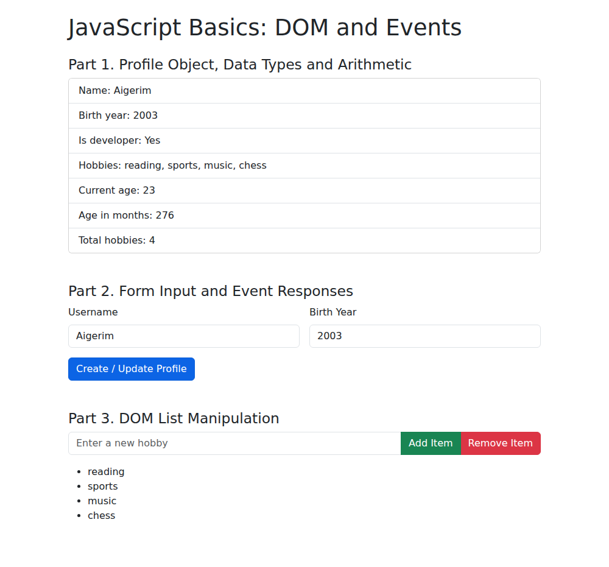
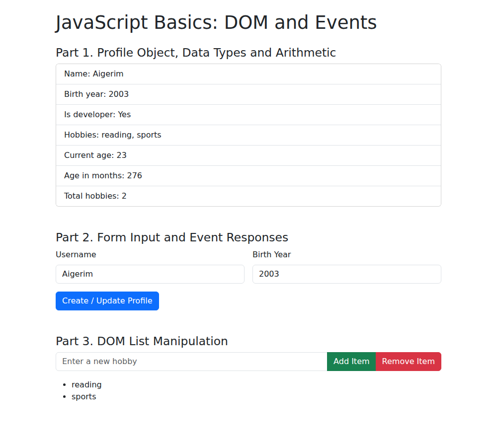

# Assignment 5. JavaScript Basics (DOM Manipulation and Events)

**Name:** Bissentayev Madiyar
**Group:** Your Group

Files: `index.html` (page with all tasks), `script.js` (all JavaScript).

---

## Part 1. Profile Object, Data Types and Arithmetic

### Task 1. The Personal Info Object
Create a JavaScript `const` object named `userProfile` that stores various data types: string (name), number (birthYear), boolean (isDeveloper), an array (hobbies).

```js
const userProfile = {
  name: "Madiyar",                         // string
  birthYear: 2005,                         // number
  isDeveloper: true,                       // boolean
  hobbies: ["reading", "sports", "music"]  // array
};
```

Console output:

```
userProfile: {name: Madiyar, birthYear: 2005, isDeveloper: true, hobbies: Array(3)}
```



### Task 2. Arithmetic Calculations
Use arithmetic operators to calculate the user's current age dynamically (current year minus birthYear). Calculate another metric, such as how many months old they are or total hobbies count, and display these values in the console or on the page.

```js
const currentYear = new Date().getFullYear();
const age = currentYear - userProfile.birthYear;   // current age
const months = age * 12;                           // age in months
const hobbiesCount = userProfile.hobbies.length;   // total hobbies
```

Console output:

```
Age: 21
Age in months: 252
Total hobbies: 3
```

The same values are displayed on the page (see the screenshot of Task 1).

---

## Part 2. Form Input and Event Responses

### Task 3. HTML Form Setup
Create a simple form containing: an input for Username, an input for Birth Year, a "Create / Update Profile" submit button.



### Task 4. Event Listener
Add a click or submit event listener to the button. When clicked, capture the user's input values and update your `userProfile` object.

```js
profileForm.addEventListener("submit", function (event) {
  event.preventDefault();
  userProfile.name = usernameInput.value.trim();
  userProfile.birthYear = Number(birthYearInput.value);
  showProfile();
});
```

After entering `Aigerim` and `2003` and pressing the button, the object and the page are updated (age 23, 276 months):



---

## Part 3. DOM List Manipulation

### Task 5. Creating and Removing Elements
Create an unordered list (`<ul>`) representing your tasks or hobbies. Create an "Add Item" button that lets the user input and add a new `<li>` item to the list. Create a "Remove Item" button that deletes the last item from the list.

After adding the item `chess`:



After pressing "Remove Item" twice (the last two items were deleted):



---

## Summary of my work process

I started with the `userProfile` object and checked it in the console. Then I wrote functions that calculate the age with `new Date().getFullYear()` and the age in months, and a `showProfile()` function that writes the values to the page with `textContent`. For the form I used `getElementById` to read the inputs, a `submit` event listener with `preventDefault()` so the page does not reload, and updated the properties of `userProfile` (a `const` object can be changed, only the variable itself cannot be reassigned). For the list I used `createElement`, `appendChild` and `removeChild` to add and remove `<li>` elements, and I ignore empty input. The page is styled with Bootstrap.
